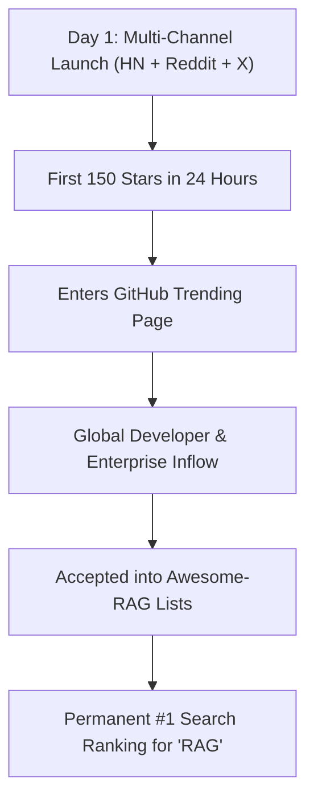

# 🚀 GitHub Global Growth & Star Acquisition Strategy
### How to Rank #1 for "RAG" & Build a Top-Trending Global Repository

---

## 📌 Executive Summary

To make your repository rank at the top when anyone worldwide searches for **"RAG"** on GitHub or Google, and to drive massive organic star growth, you need a three-pronged execution:

1. **GitHub Algorithmic Search Optimization (On-Page SEO)**
2. **Community Health & Repository Authority Signals**
3. **Viral Launch & Multi-Channel Distribution Loop (Hacker News, Reddit, X, Awesome-Lists)**

---

## 🔍 1. GitHub Search Algorithm: How to Rank #1 for "RAG"

GitHub's search ranking algorithm evaluates specific on-page fields in a strict hierarchy:

### A. Repository Settings Optimization
Configure these directly in your GitHub repo settings:

* **Repository Title**: Keep it clean and search-rich:
  `rag-system-builder` or `rag-skills-vibe-coder`
* **Repository Description (About section)**:
  > *"Production-grade, zero-hallucination RAG framework for vibe coders. 13 modular skills, hybrid BM25 + vector search, 5-layer anti-hallucination guardrails, and automated evaluation."*
* **Website Field**: Point to a live GitHub Pages demo or documentation URL.
* **Topics (Tags)** — **Crucial for GitHub Search Ranking**:
  Add all 20 topic tags:
  ```
  rag, retrieval-augmented-generation, anti-hallucination, vibe-coding, 
  llm, hybrid-search, bm25, vector-database, evaluation, guardrails, 
  local-rag, ollama, chromadb, pgvector, docling, python, 
  ai-agent, zero-hallucination, machine-learning, artificial-intelligence
  ```

### B. Readme Search Ranking Signals
* **H1 Title**: Must contain the exact keyword phrase `RAG SYSTEM`.
* **First 150 Words**: Must mention `RAG`, `Retrieval-Augmented Generation`, `hybrid search`, `anti-hallucination`, and `vibe coder`.
* **Heading Frequency**: Use semantic subheadings like `Why RAG Hallucinates`, `Hybrid Retrieval Architecture`, and `Evaluation Metrics`.

---

## 🌐 2. The 0 to 10,000 Stars Viral Playbook

GitHub stars follow a **velocity-based flywheel**. If you acquire 100–200 stars within 24 hours of launch, GitHub's algorithm automatically places your repo on the **GitHub Trending Page** (Python & Global). Once on Trending, you gain 500–2,000 stars per day organically.



---

## 📢 3. Ready-to-Use Launch Post Templates

### Channel 1: Hacker News (news.ycombinator.com)
* **Title**: `Show HN: A zero-hallucination RAG framework for vibe coders`
* **Body Draft**:
  > *Hi HN,*  
  > *Most RAG tutorials jump straight to LangChain/LlamaIndex without addressing the fundamental problem: models hallucinate when evidence is missing.*  
  > *I built this open-source framework with 13 modular skills specifically for "vibe coders" and engineers who want a system that strictly says "I don't know" instead of making up answers.*  
  > *Features:*  
  > *- 5-layer fail-closed anti-hallucination defense (score gating, verified citations, claim checking)*  
  > *- Hybrid retrieval (BM25 + Dense RRF)*  
  > *- Dual-engine: works completely offline without API keys or with local Ollama*  
  > *- Tested on 120,000+ official CMS medical coding records with 0% false answers on trap questions.*  
  > *Repo: [GitHub Link]*  
  > *Feedback and PRs welcome!*

### Channel 2: Reddit (`r/LocalLLaMA`, `r/MachineLearning`, `r/Python`)
* **Title**: `[P] Built a 13-skill RAG system that strictly says "I don't know" instead of guessing (runs 100% offline)`
* **Hook**: Emphasize privacy, local execution via Ollama/CPU, and the measured 0% hallucination rate on the golden test set.

### Channel 3: X / Twitter Viral Technical Thread
* **Tweet 1 (Hook)**:
  > *"90% of RAG implementations fail because they guess when documents lack answers.*  
  > *Here is an open-source, 13-skill blueprint designed for vibe coders that enforces a 5-layer fail-closed defense: 🧵👇"*
* **Tweet 2**: Visual diagram of the 5-layer defense.
* **Tweet 3**: Screenshot of the chat interface showing exact ICD-10 medical code citations and the strict "I don't know" fallback.
* **Tweet 4**: GitHub link with a call-to-action to star ⭐ the repo.

---

## 🤝 4. Pull Request Outreach to "Awesome-RAG" Curators

Submit pull requests to add your repository to the top curated AI lists:
1. **`NirDiamant/RAG_Techniques`** (Popular RAG reference repo)
2. **`awesome-rag`** (Curated lists with 15k+ stars)
3. **`awesome-generative-ai`**

**PR Message Template**:
> *"Added RAG System with Vibe Code Skills under Frameworks & Anti-Hallucination: A production-grade 13-skill modular RAG architecture featuring hybrid retrieval, fail-closed score gating, and automated golden evaluation."*

---

## 📈 5. Growth Milestones Checklist

- [ ] **Milestone 1**: Set up GitHub Repository About, Description, and 20 Topic Tags.
- [ ] **Milestone 2**: Publish the Hacker News Show HN launch during US peak hours (8 AM - 10 AM EST).
- [ ] **Milestone 3**: Post the technical demo thread on X and Reddit (`r/LocalLLaMA`).
- [ ] **Milestone 4**: Submit PRs to 3 "Awesome-RAG" repositories.
- [ ] **Milestone 5**: Monitor Star Velocity to hit GitHub Trending status.
