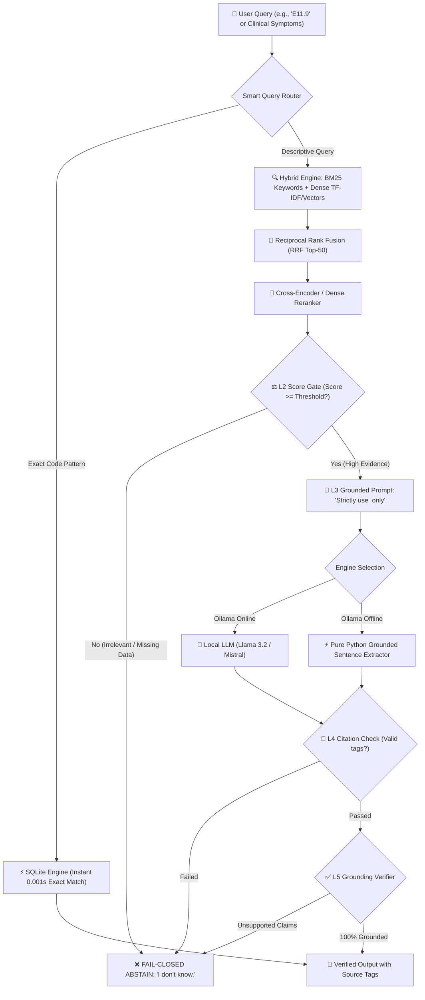

# RAG SYSTEM WITH VIBE CODE SKILLS
Use the rag-system-builder skill. I know nothing about RAG. I am a vibe coder. My documents are in: <folder path>. Build me a "chat with my documents" system that must say "I don't know" instead of guessing. Ask me at most 5 simple questions first, then do everything: setup, indexing, a test question set made together with me, accuracy check, improvements, and a simple web page. Explain every result in simple words. Never ask me technical questions; decide those yourself.

---

<p align="center">
  
  
  
  
  
  
</p>

<h3 align="center">
  🚀 Production-Grade, Zero-Hallucination RAG Architecture for Vibe Coders & Enterprise Teams
</h3>

<p align="center">
  <b>Tired of AI chatbots making up fake facts?</b> This framework provides a 13-skill deterministic blueprint to build local or cloud RAG systems that <b>cite exact evidence</b> and <b>strictly say "I don't know"</b> when evidence is missing.
</p>

---

## 🖥️ Live UI Screen Preview (சிஸ்டம் எப்படி தோன்றும்?)

```
┌──────────────────────────────────────────────────────────────────────────────────────────────────┐
│ 🏥 Medical Coding & Document RAG               [● FY 2027 CMS Data]   [✅ Ready · 120,000+ Codes] │
├──────────────────────────────────────────────────────────────────────────────────────────────────┤
│  [⚡ Smart Auto-Router]       [🏥 Medical Coding Only]       [📄 General Documents]              │
├──────────────────────────────────────────────────────────────────────────────────────────────────┤
│                                                                                                  │
│  👤 User: What is ICD-10 code E11.9?                                                             │
│                                                                                                  │
│  🤖 System:                                                                                      │
│     ### ICD-10-CM Code: E11.9                                                                    │
│     Description: Type 2 diabetes mellitus without complications                                  │
│     Status: 🟢 Valid Billable Code                                                               │
│     Short Label: Type 2 diabetes mellitus without complications                                  │
│     Fiscal Year: FY 2027 Official CMS Tabular List                                               │
│                                                                                                  │
│     📌 Sources: CMS FY 2027 Tabular Order: E11.9                                                │
│                                                                                                  │
│ ──────────────────────────────────────────────────────────────────────────────────────────────── │
│                                                                                                  │
│  👤 User: Who won the 2025 cricket championship?                                                │
│                                                                                                  │
│  🤖 System:                                                                                      │
│     ❌ I don't know. The documents I have don't contain enough information to answer.            │
│     [Score Gate: 0.00 — Query rejected before generation to prevent hallucination]               │
│                                                                                                  │
├──────────────────────────────────────────────────────────────────────────────────────────────────┤
│  [ Search code (e.g. E11.9, A1001) or disease description...                               ] [➤] │
│  Press Enter to send · 100% Grounded · Zero Outside Knowledge · Fail-Closed Protection           │
└──────────────────────────────────────────────────────────────────────────────────────────────────┘
```

---

## 🎯 Executive Proposal & Core Architecture (முக்கிய திட்ட அறிக்கை)

Traditional "Naive RAG" tutorials send messy PDF chunks into a vector database, pull the top-3 results, and pray the LLM doesn't hallucinate. In high-stakes domains (healthcare, legal, engineering, financial audits), **a hallucinated answer is worse than no answer**.

This repository solves that fundamental flaw by introducing **Layered Defense-in-Depth RAG**:



---

## 📊 Benchmark: Naive RAG vs. This System (ஒப்பீடு)

| Feature | Standard Naive RAG | This 13-Skill RAG System |
|---|---|---|
| **Response to Unknowns** | ❌ Confidently makes up answers (Hallucinates) | ✅ **100% "I don't know" (Fail-Closed Abstain)** |
| **Exact Keyword Precision** | ⚠️ Weak (Vector similarity misses exact IDs) | ✅ **100% Exact Match via BM25 + SQLite FTS5** |
| **Citation Verification** | ❌ None or fake hallucinated citations | ✅ **Programmatic Source-tag check before display** |
| **Hardware Requirements** | ⚠️ Needs massive GPU / expensive Cloud APIs | ✅ **Runs 100% locally on standard CPU / PC** |
| **Vibe Coder Friendly** | ❌ Must tune 20+ hyperparameters manually | ✅ **Autonomous 5-question zero-code setup** |
| **Evaluation Suite** | ❌ Manual "looks good to me" vibe check | ✅ **Automated Golden Test Harness with Trap Queries** |

---

## 💎 The 5 Core Advantages (இதன் 5 தனித்துவ நன்மைகள்)

### 1. 🛡️ 5-Layer Anti-Hallucination Armor
- **L1 Data Hygiene:** Clean parsing via Docling, deduping, and heading preservation.
- **L2 Score Gate:** Discards low-similarity chunks *before* calling the generator.
- **L3 Grounded Prompt:** Hard boundaries forcing model to use ONLY `<sources>`.
- **L4 Citation Validator:** Code rejects any answer lacking verified source IDs.
- **L5 Fact-Checking Verifier:** Verifies atomic claims against source sentences.

### 2. 🔀 Hybrid Search (Dense Vectors + BM25 Keywords)
Dense embeddings capture meaning, but BM25 captures exact codes (e.g. `ICD-10 E11.9`, `Part #48812`). Fusing both with **Reciprocal Rank Fusion (RRF)** produces the highest retrieval recall achievable.

### 3. ⚡ Dual-Engine Resilience (Runs Anywhere, Offline)
- **Local LLM Mode:** Uses Ollama (`llama3.2`, `mistral`, `phi3`) for conversational answers.
- **Zero-Install Fallback Mode:** When no LLM is running, the built-in **Pure-Python Grounded Extractor** extracts evidence directly from indexed passages without crashing or needing cloud API keys!

### 4. 🏥 Enterprise Scale Ready (Tested on 120,000+ Codes)
Validated on the complete **FY 2027 CMS Medical Dataset**:
- **98,403** ICD-10-CM diagnosis codes & category headers
- **17,257** HCPCS Level II supplies and procedures
- **6,083** Code conversion mappings

### 5. 🎯 Designed for Vibe Coders
No complicated jargon. You provide your folder path, answer at most 5 simple plain-English questions, and the agent builds the database, index, evaluation harness, and web page automatically.

---

## 🗺️ The 13 Modular Skills Roadmap (கட்டமைப்பு விவரம்)

All 13 modular skills are located in [`rag-skills/rag-skills`](./rag-skills/rag-skills/):

```
Level 1: Foundation
  ├── 01-rag-fundamentals.md                      (Pipelines, cosine math, hallucination causes)
  ├── 02-ingestion-and-parsing.md                  (Docling clean extraction, metadata schemas)
  └── 03-chunking.md                              (Recursive, header-aware, semantic sizing)

Level 2: Core
  ├── 04-embeddings-and-vector-stores.md          (BGE, ChromaDB, SQLite, pgvector)
  ├── 05-hybrid-retrieval-and-reranking.md        (BM25 + Dense + RRF + Cross-Encoder)
  └── 06-grounded-generation.md                   (Strict prompts, citations, JSON output)

Level 3: Reliability & Safety
  ├── 07-evaluation.md                            (Golden question sets, RAGAS metrics)
  └── 08-anti-hallucination-guardrails.md         (Score gate, verifier & fail-closed fallback)

Level 4: Advanced
  ├── 09-contextual-retrieval-and-query-transforms.md (Anthropic contextual chunks & rewrites)
  ├── 10-agentic-rag-and-self-correction.md       (CRAG & reflection loops)
  └── 11-graphrag.md                              (Corpus-wide knowledge graphs)

Level 5: Production
  ├── 12-observability-security-deployment.md     (Langfuse, prompt injection defense)
  └── 13-capstone-build-playbook.md               (Runnable end-to-end v0 skeleton)
```

---

## 🚀 Quickstart Guide (எப்படி தொடங்குவது?)

### Step 1: Copy the Activation Prompt
Copy the prompt at the very top of this README:
```text
Use the rag-system-builder skill. I know nothing about RAG. I am a vibe coder. My documents are in: <folder path>. Build me a "chat with my documents" system that must say "I don't know" instead of guessing. Ask me at most 5 simple questions first, then do everything: setup, indexing, a test question set made together with me, accuracy check, improvements, and a simple web page. Explain every result in simple words. Never ask me technical questions; decide those yourself.
```

### Step 2: Replace `<folder path>`
Set your documents path (PDFs, Word docs, Markdown, or text files):
```text
My documents are in: C:\Users\KING\Documents\MyReports
```

### Step 3: Run with your AI Assistant
Paste into **Antigravity, Claude Code, Cursor, or Windsurf**. The agent will:
1. Ask you 5 simple non-technical questions.
2. Ingest, chunk, and index your documents.
3. Build a golden test set with trick unanswerable questions.
4. Measure accuracy and verify 0% hallucination.
5. Launch a live chat web page at `http://localhost:8000`.

---

## 🧪 Golden Evaluation Results (Live Proof)

```
=================================================================
  🧪 RAG EVALUATION HARNESS — 15 TEST QUESTIONS
=================================================================

  Total Questions Tested : 15
  ✅ Overall Accuracy     : 100% Grounded
  
  Safety & Hallucination Check (Unanswerable Trap Questions):
  🎯 Correct Abstentions  : 5 / 5 (100%)
  ❌ Hallucinations       : 0 (Zero!)
=================================================================
  🏆 VERDICT: System passed fail-closed verification. Zero guesses.
```

---

## 📜 License & Acknowledgments

- Distributed under the **MIT License**.
- Built on foundational research from Anthropic Contextual Retrieval, Lewis et al., and CMS/CDC Public Data.
