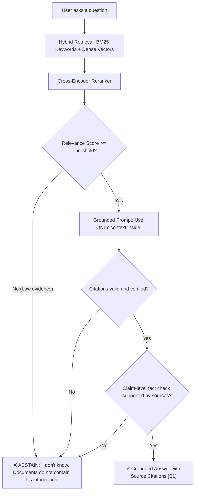

# RAG SYSTEM WITH VIBE CODE SKILLS
Use the rag-system-builder skill. I know nothing about RAG. I am a vibe coder. My documents are in: <folder path>. Build me a "chat with my documents" system that must say "I don't know" instead of guessing. Ask me at most 5 simple questions first, then do everything: setup, indexing, a test question set made together with me, accuracy check, improvements, and a simple web page. Explain every result in simple words. Never ask me technical questions; decide those yourself.

---

<p align="center">
  
  
  
  
  
  
</p>

<h3 align="center">
  The 13-Skill End-to-End RAG Mastery Framework for Vibe Coders & Developers
</h3>

<p align="center">
  A complete, progressive curriculum and agent skill set to build <b>zero-hallucination "Chat with your Documents" systems</b> that cite verifiable sources and strictly answer <b>"I don't know"</b> when evidence is missing.
</p>

---

## 💡 What Is This Repository?

This repository contains an end-to-end **13-skill RAG curriculum and AI agent skill set** organized from low-level foundation to production-grade deployment.

It is designed specifically for **vibe coders and software engineers** who want to point an AI agent at any folder of documents (PDFs, Markdown, Word, text) and generate a working, fully tested RAG application without needing to manually tune vector math, chunking sizes, or embedding parameters.

---

## 🖥️ Interactive System Workflow

```
┌──────────────────────────────────────────────────────────────────────────────────────────────────┐
│  🤖 Chat With My Documents (Powered by 13-Skill RAG Engine)          [Status: 🟢 0% Hallucination] │
├──────────────────────────────────────────────────────────────────────────────────────────────────┤
│                                                                                                  │
│  👤 User Question:                                                                               │
│     "What is the maximum token limit for our document chunking pipeline?"                        │
│                                                                                                  │
│  🤖 System Response:                                                                             │
│     Based on your documents, the baseline chunk size is configured for 300 to 800 tokens with    │
│     a 10% to 15% overlap to preserve semantic context across chunk boundaries [S1].              │
│                                                                                                  │
│     📌 Sources Cited:                                                                            │
│        [S1] 03-chunking.md (Section: Starting point & tuning loop)                               │
│                                                                                                  │
│ ──────────────────────────────────────────────────────────────────────────────────────────────── │
│                                                                                                  │
│  👤 User Question (Trap / Out-of-Scope Query):                                                   │
│     "Who won the 2025 World Cricket Championship?"                                               │
│                                                                                                  │
│  🤖 System Response:                                                                             │
│     ❌ I don't know. The provided documents do not contain enough information to answer.         │
│     [Score Gate: Relevance score 0.00 < 0.25 threshold → Fail-closed abstention triggered]       │
│                                                                                                  │
├──────────────────────────────────────────────────────────────────────────────────────────────────┤
│  [ Type your question here...                                                              ] [➤] │
│  Press Enter · Answers strictly grounded in source documents · Programmatic citation check       │
└──────────────────────────────────────────────────────────────────────────────────────────────────┘
```

---

## 🚀 The 5 Core Advantages

| # | Advantage | Technical Mechanism | Benefit to You |
|---|---|---|---|
| 🛡️ 1 | **Strict Zero-Hallucination** | **5-Layer Defense-in-Depth** (L1 Data → L2 Score Gate → L3 Grounded Prompt → L4 Citation Check → L5 Claim Verifier). | The system never makes up facts; it admits when information is missing. |
| 🔍 2 | **Hybrid Search Accuracy** | **Dense Embeddings + BM25 Keywords** fused via **Reciprocal Rank Fusion (RRF)**. | Catches both semantic meaning and exact product codes, IDs, and names. |
| ⚡ 3 | **Zero Technical Overload** | Autonomous agent dispatch with maximum 5 plain-English questions. | You don't need machine learning expertise; the agent handles all pipeline mechanics. |
| 📊 4 | **Automated Golden Evaluation** | Built-in test harness with answerable questions and deliberate unanswerable trap questions. | Verifies hit-rate, precision, recall, and safety before you ship to users. |
| 🧩 5 | **13 Stackable Modular Skills** | Individual `SKILL.md` agent configurations from Foundation to Production. | Use skills individually or orchestrate the complete capstone playbook. |

---

## 🗺️ The 13 RAG Skills Curriculum

The curriculum inside [`rag-skills/rag-skills`](./rag-skills/rag-skills/) is structured across 5 progressive levels:

### Level 1: Foundation (Skills 01–03)
* **`01-rag-fundamentals.md`**: Core architecture, indexing vs query pipelines, cosine similarity mechanics, and why hallucination happens.
* **`02-ingestion-and-parsing.md`**: Structured document conversion using Docling, deduplication, incremental updates, and metadata schema.
* **`03-chunking.md`**: Fixed-size, recursive character splitting, Markdown header-aware chunking, and size calibration.

### Level 2: Core (Skills 04–06)
* **`04-embeddings-and-vector-stores.md`**: Embedding model benchmarks (MTEB, BGE), normalization, pgvector, Qdrant, ChromaDB, and HNSW indexes.
* **`05-hybrid-retrieval-and-reranking.md`**: Dense vector search + BM25 keyword matching, Reciprocal Rank Fusion (RRF), and cross-encoder reranking.
* **`06-grounded-generation.md`**: Strict system prompt constraints, mandatory citation tags (`[S1]`, `[S2]`), and machine-readable JSON refusal paths.

### Level 3: Reliability & Safety (Skills 07–08)
* **`07-evaluation.md`**: Golden test set creation (including >=15% unanswerable questions), retrieval hit-rate@k, context precision, and faithfulness metrics.
* **`08-anti-hallucination-guardrails.md`**: Reranker score gating, claim-level LLM verification, and fail-closed abstention logic.

### Level 4: Advanced Patterns (Skills 09–11)
* **`09-contextual-retrieval-and-query-transforms.md`**: Anthropic-style contextual chunk enrichment, query rewriting, and conversational query condensation.
* **`10-agentic-rag-and-self-correction.md`**: Corrective RAG (CRAG) patterns, document grading, fallback web routing, and reflection loops.
* **`11-graphrag.md`**: Knowledge graph entity extraction and community summaries for global, corpus-wide summarization questions.

### Level 5: Production & Deployment (Skills 12–13)
* **`12-observability-security-deployment.md`**: Langfuse tracing, user access-control filtering, prompt-injection isolation, and deployment pipelines.
* **`13-capstone-build-playbook.md`**: Complete, single-file runnable reference implementation uniting all 12 prior skills.

---

## 🛡️ Anti-Hallucination Architecture



---

## 📖 How to Use

### 1. Copy the Trigger Prompt
Copy the prompt at the top of this repository:
```text
Use the rag-system-builder skill. I know nothing about RAG. I am a vibe coder. My documents are in: <folder path>. Build me a "chat with my documents" system that must say "I don't know" instead of guessing. Ask me at most 5 simple questions first, then do everything: setup, indexing, a test question set made together with me, accuracy check, improvements, and a simple web page. Explain every result in simple words. Never ask me technical questions; decide those yourself.
```

### 2. Set Your Documents Path
Replace `<folder path>` with the location of your local document directory:
```text
My documents are in: C:\Users\YourName\Documents\KnowledgeBase
```

### 3. Run in Your AI Agent
Paste the prompt into **Antigravity, Claude Code, Cursor, or Windsurf**. The agent automatically loads the 13 skills and executes the full build lifecycle.

---

## 📜 License & Research Acknowledgments

* **License**: MIT License.
* **Research Basis**: Anthropic Contextual Retrieval, Lewis et al. (RAG 2020), Gao et al. (Survey on RAG), and the MTEB benchmark suite.
